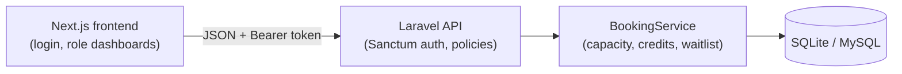

# Studio Booking

Class booking and memberships for small gyms, yoga and fitness studios. A Laravel REST API with a Next.js frontend.

## What it does

- **Members** see the weekly schedule, book a class, cancel, and check their membership.
- **Instructors** create and edit their own classes and see who is booked.
- **Admins** manage all classes and members' memberships.

Booking rules live in one place, `backend/app/Services/BookingService.php`:

- a member needs an active membership (unlimited, student or pay-per-class);
- pay-per-class memberships spend one credit per booked class;
- when a class is full, new bookings go to a waitlist;
- when someone cancels, the first person on the waitlist is moved into the class automatically;
- double bookings are rejected, and rows are locked during booking so two people can't take the last spot at once.



## Stack

- Backend: PHP 8.3+, Laravel 13, Laravel Sanctum (token auth), PHPUnit feature tests
- Frontend: Next.js 16, React 19, TypeScript, Tailwind CSS 4
- Database: SQLite for local work, MySQL works too

## Run locally

You need PHP 8.3+, Composer and Node.js 20+.

Backend (http://localhost:8000):

```bash
cd backend
composer install
cp .env.example .env
php artisan key:generate
touch database/database.sqlite   # if you use SQLite (check DB_CONNECTION in .env)
php artisan migrate --seed
php artisan serve
```

Frontend (http://localhost:3000), in a second terminal:

```bash
cd frontend
npm install
npm run dev
```

The frontend calls `http://localhost:8000/api` by default. To point it somewhere else, set `NEXT_PUBLIC_API_URL` in `frontend/.env.local`.

### Demo accounts

The seeder creates sample classes, bookings and one full class with a waitlist. All passwords are `password`.

| Role | Email |
| --- | --- |
| Admin | admin@example.com |
| Instructor | ivy@example.com |
| Member | mia@example.com |
| Member, pay-per-class | max@example.com |
| Member, expired membership | eli@example.com |
| Member, no membership | nora@example.com |

## Tests

```bash
cd backend
php artisan test
```

Covers auth, role permissions, booking, capacity, waitlist and cancellation.

## API

All routes are under `/api`. Everything except `register` and `login` needs a `Authorization: Bearer <token>` header.

| Method | Path | |
| --- | --- | --- |
| POST | /register, /login, /logout | auth |
| GET | /me | current user |
| GET, POST, PUT, DELETE | /studio-classes | classes |
| GET, POST, PUT, DELETE | /memberships | memberships |
| GET, POST, DELETE | /bookings | book and cancel |

## License

MIT, see [LICENSE](LICENSE).
